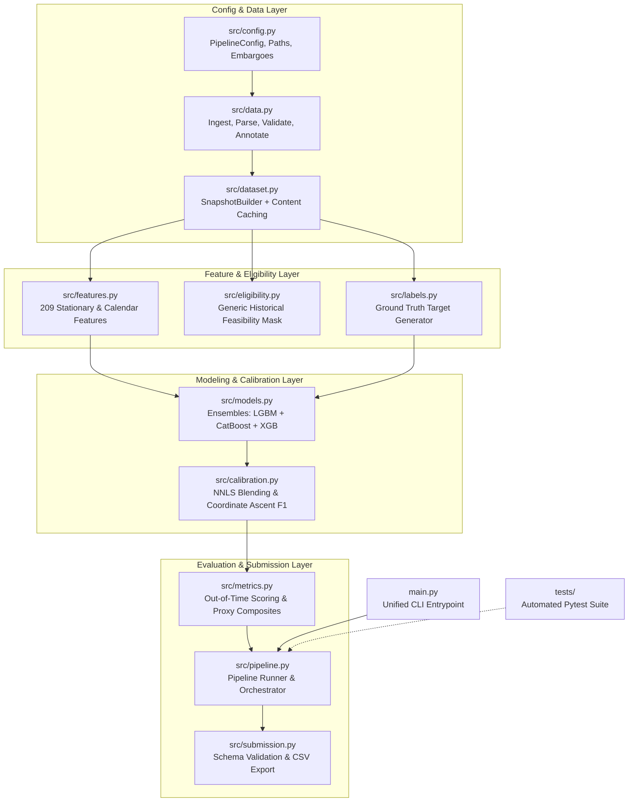

# Architecture & Refactor Blueprint

**Sasol Customer Lifetime Value (CLV) & Opportunity Prediction System**  
**Version**: 2.0.0 (Production Modular Architecture)  

---

## 1. System Architecture Overview

The codebase has been refactored from procedural monolithic scripts into a modular, production-grade architecture under `src/`. Each module possesses a single responsibility, full Python type hints, docstrings, vectorization, and deterministic pipeline steps.



---

## 2. Modular Component Breakdown

### 2.1 Configuration Layer (`src/config.py`)
- **`PipelineConfig`**: Central, immutable dataclass containing paths, random seeds, temporal snapshot intervals, and training embargo logic.
- **`training_cutoffs(boundary)`**: Mathematical function computing all snapshot dates whose 3-month outcome window strictly completes before `boundary`, preventing cross-horizon target leakage.

### 2.2 Data Ingestion & Sanitization (`src/data.py`)
- **`load_transactions`**: Vectorized ingestion using `label_rules.prepare` for micro-unit integer precision (`SCALE = 1,000,000`).
- **`validate_raw_schema`**: Fails fast if required columns are missing or if literal `"NA"` categories have been corrupted into null values.
- **`annotate`**: Computes boolean flags (`in_scope`, `is_qualifying`, `is_fuel_sale`, `is_nonfuel`) once at ingestion time.

### 2.3 Feature Engineering Engine (`src/features.py`)
- **209 High-Signal Features** extracted per customer strictly before cutoff date $t$:
  1. **Calendar Windows**: Aggregated across `1m`, `3m`, `6m`, `q2` (months 6 to 3 prior), and `yoy` (same season 1 year prior) using `pd.DateOffset(months=K)`.
  2. **Stationary Rates**: Lifetime aggregates normalized by customer tenure into monthly rates (`baskets_per_month_life`, `fuel_litres_per_month_life`, `nonfuel_rand_per_month_life`) to prevent calendar-shift drift between training and test sets.
  3. **Honest Censoring**: Windows extending prior to the earliest transaction date are filled with `NaN` rather than `0.0`.
  4. **Activity Slopes**: 6-month ordinary least squares (OLS) slopes on monthly qualifying basket counts.
  5. **Category Baselines**: Exact historical spend in the preceding quarter matching Rule 5 growth baseline definitions.

### 2.4 Mathematical Eligibility Masking (`src/eligibility.py`)
- **`mask_from_history`**: Generic, dynamic derivation of the $N \times 17$ feasibility matrix from `label_config.json['category_mapping']`.
- Automatically enforces:
  - $P(\text{Existing-category growth}: C) = 0$ if category $C$ was never purchased.
  - $P(\text{New category adoption}: C) = 0$ if category $C$ was ever previously purchased.
  - Leaves `Inactivity` and `Stable` as universally accessible.

### 2.5 Machine Learning Ensembles (`src/models.py`)
- **`RegressorEnsemble`**: LightGBM, CatBoost, and XGBoost regressor instances fitted with squared error objectives.
- **`ClassifierEnsemble`**: LightGBM and CatBoost multiclass probabilistic classifiers.
- **Class Alignment Fix**: Dynamically aligns predicted probability columns to the global 17-class label space using `np.unique(y)` indices, eliminating the legacy silent padding shift.
- **Bagging Fix**: Explicitly sets `subsample_freq=1` in LightGBM to activate row subsampling.

### 2.6 Metric Optimization & Calibration (`src/calibration.py`)
- **`fit_blend_weights`**: Fits non-negative least squares (NNLS) weights on the calibration fold (`2025-06-01`), automatically finding optimal model blends.
- **`fit_class_weights`**: Replaces the ineffective Nelder-Mead simplex method with multi-pass **Coordinate Ascent** over a geometric multiplier grid, boosting weighted F1 on validation sets.

### 2.7 Submission & Integrity (`src/submission.py`)
- **`validate_submission`**: Exhaustive schema verification checking row count (5,488), exact ID matching with `SampleSubmission.csv`, non-negativity ($z \ge 0$), and adherence to the 17 authoritative Opportunity class labels.

---

## 3. Execution & Testing Instructions

### 3.1 Running the Automated Test Suite
To verify data integrity, feasibility masking, calibration logic, and submission validation:
```bash
.venv/bin/pytest tests/ -v
```

### 3.2 Executing the End-to-End Pipeline
To run the full training, validation, retraining, and submission generation:
```bash
.venv/bin/python main.py
```

#### Available CLI Arguments:
- `--no-cache`: Force recomputation of feature matrices and snapshot parquets.
- `--first-train-cutoff`: Earliest snapshot cutoff (default: `2024-07-01`).
- `--calibration-cutoff`: Snapshot cutoff for blend and threshold calibration (default: `2025-06-01`).
- `--evaluation-cutoff`: Snapshot cutoff for out-of-time evaluation (default: `2025-09-01`).
- `--seed`: Random seed for model training (default: `42`).

### 3.3 Output Files
- **Submission**: `submission.csv` (root directory, ready for direct Zindi upload).
- **Execution Report**: `reports/evaluation_report.json` (detailed metric breakdowns and class distributions).
